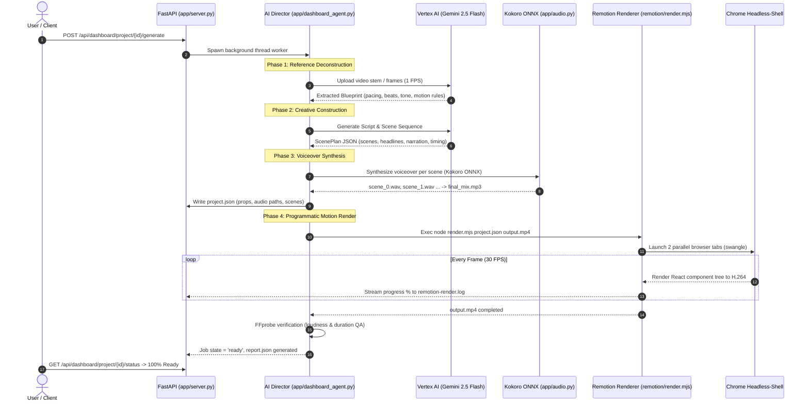

# MotionClone: System Architecture, Pipeline Data Flow & LLM Optimization Guide

> **Audience:** This document is designed for frontier Large Language Models (such as Claude 3.5 Sonnet, Claude 3.7 Sonnet/Opus, or GPT-4o) and engineers tasked with analyzing, optimizing, and accelerating the MotionClone video generation pipeline. It details the complete end-to-end architecture, codebase file map, data contracts, Remotion rendering mechanics, performance bottlenecks, and concrete optimization vectors.

---

## 1. Executive Summary & Tech Stack

**MotionClone** (formerly FrameForge) is an automated, AI-directed motion-graphics explainer platform. It analyzes reference videos, extracts their narrative structure, pacing, and visual metaphors, and programmatically generates, voices, and renders high-fidelity 30 FPS vertical (9:16) or horizontal (16:9) motion-graphics explainer videos.

### Core Technology Stack:
* **Backend API & Orchestration:** Python 3.12 + FastAPI + Uvicorn (async job queue + thread workers).
* **Multimodal Intelligence:** Google Gemini 2.5 Flash via Vertex AI (`us-central1` / `global`) for reference video deconstruction and script/blueprint authoring.
* **Voiceover Synthesis (TTS):** Kokoro ONNX running locally inside the container (100% free, zero external API latency or cost).
* **Audio Engineering:** FFmpeg + `pyloudnorm` for multi-track audio mixing, ducking, and EBU R128 loudness normalization (-14 LUFS).
* **Motion Graphics Engine:** Remotion React 18 (`@remotion/renderer` + `@remotion/bundler`) running on Node.js 22 LTS with Chromium `chrome-headless-shell`.
* **Hosting & Compute:** Google Cloud Run (containerized, serverless on-demand, auto-scaling from 0 to 1 instance).

---

## 2. Codebase Map & Directory Structure

```
.
├── Dockerfile                  # Multi-runtime image (Python 3.12 + Node 22 + Chromium headless-shell + Kokoro)
├── cloudrun-env.yaml           # Cloud Run environment variables (Vertex AI, Firebase Auth, allowed emails)
├── deploy-gcp.ps1 / .sh        # Cloud Run deployment scripts (4 vCPU / 8Gi, min-instances 0, cpu-throttling)
├── requirements.txt            # Python dependencies (FastAPI, google-genai, onnxruntime, soundfile, pytest)
├── app/                        # Python backend core
│   ├── server.py               # FastAPI application, route handlers, auth gating, static mounting
│   ├── dashboard_routes.py     # Endpoints for Dashboard Pro: /generate, /status, /save-blueprint
│   ├── dashboard_agent.py      # AI Director agent: deconstruct reference, draft script, orchestrate pipeline
│   ├── pipeline.py             # Main end-to-end pipeline coordinator
│   ├── remotion.py             # Remotion renderer wrapper, stall watchdog, inputProps builder, verification
│   ├── audio.py                # Audio mixing, Kokoro TTS integration, EBU R128 loudness measurement
│   ├── media.py                # FFmpeg wrappers: probe, video slicing, keyframe extraction, thumbnailing
│   ├── models.py               # Pydantic data schemas: Plan, ScenePlan, Scene, Brief, Verification
│   ├── ai.py                   # Vertex AI / Gemini API client, multimodal video prompts, fallback logic
│   ├── rebuild_author.py       # Algorithmic construction of scenes, shot timings, and kinetic motion rules
│   ├── reconstruction.py       # Frame-level reference video reverse engineering
│   ├── recording_routes.py     # Recording studio / webcam explainer export routes
│   ├── credits.py              # User credit balances, consumption tracking, and Firestore integration
│   ├── auth.py                 # Firebase Admin token verification with fail-closed security
│   └── tts/
│       ├── kokoro_provider.py  # Local Kokoro ONNX model loader, phonemizer, and WAV generator
│       └── registry.py         # Voice catalog (English & Hindi voices: am_adam, af_sarah, hf_alpha, etc.)
├── remotion/                   # Remotion React project
│   ├── package.json            # Node dependencies: remotion, @remotion/renderer, @remotion/bundler, react 18
│   ├── render.mjs              # Standalone Node rendering script: bundler cache, browser args, cancelSignal
│   └── src/
│       ├── index.jsx           # Root composition registrations (<Composition id="Motion" ... />)
│       ├── Composition.jsx     # Master explainer composition + 13 scene templates + SubtitleOverlay
│       ├── theme.js            # Design system: palettes, typography scale, safe-margins, responsive layout
│       ├── components/
│       │   ├── DynamicEnvironment.jsx # Ambient background lighting, subtle moving grids, particle glow
│       │   ├── DataVisualizations.jsx # Animated charts, working capital bars, inflow splits, metric rings
│       │   ├── AnimatedProps.jsx      # Vector illustrations, badges, locked vaults, credit cards
│       │   ├── StickmanCharacter.jsx  # Skeletal vector stickman animations (talking, thinking, walking)
│       │   └── SafeAsset.jsx          # Error-boundary image asset loader (prevents render crashes)
│       ├── templates/
│       │   └── CharacterStory.jsx     # High-retention character narrative template
│       └── transitions/
│           └── SceneTransition.jsx    # Spring physics camera zooms, direction wipes, hard cuts
├── static/ & web/              # Frontend web application
│   ├── dashboard.html          # Dashboard Pro interface
│   ├── js/dashboard.js         # Reactive UI controller, timeline editor, blueprint inspector, log monitor
│   └── css/dashboard.css       # Dark-mode technical studio styling
└── tests/                      # Automated test suite
    ├── test_phase8_acceptance.py # Comprehensive end-to-end acceptance tests
    └── test_dashboard_routes.py  # Route tests for generation, polling, and status
```

---

## 3. End-to-End Execution Flow



---

## 4. Detailed Pipeline Step-by-Step

### Step 1: Ingestion & Project Initialization
* A project directory `/data/projects/{job_id}/` is created.
* User provides a reference video URL, uploaded MP4, or a raw text prompt + target duration (e.g. 30s, 60s).
* Target aspect ratio is set: `9:16` (1080×1920) for Shorts/Reels/TikTok, `16:9` (1920×1080) for YouTube/Desktop, or `1:1` (1080×1080).
* Frame rate is locked to **strictly 30.0 FPS** (enforced across the codebase).

### Step 2: Reference Deconstruction (`app/reconstruction.py` & `app/ai.py`)
* If a reference video is provided, FFmpeg extracts keyframes at 1 FPS or uploads the video to Vertex AI.
* Gemini 2.5 Flash executes a structured prompt (`SYSTEM_PROMPT_DECONSTRUCT`) to extract:
  * Number of scenes and exact cut timestamps.
  * Motion style (fast cuts, kinetic text pops, split comparisons).
  * Narrative arc (Hook $\to$ Problem $\to$ Solution $\to$ Social Proof $\to$ CTA).

### Step 3: Script & Motion Blueprint Authoring (`app/rebuild_author.py`)
* Gemini generates a strictly typed `scene_plan.json` matching `models.ScenePlan`.
* **Important Design Rule:** Narration script (`voiceover_script_en` / `voiceover_script_hi`) is kept strictly separated from on-screen headlines (`headline`) to prevent screen clutter.
* Each scene is assigned one of **13 registered templates**:
  1. `kinetic_text`: Typographic word-level spring pop reveal.
  2. `fact_card`: Verified claim card with animated pill and source badge.
  3. `dashboard_showcase`: Floating screenshot with 3D tilt, spring float, and cursor ripple.
  4. `stat_counter`: Numeric counter ramping with spring physics and accent glow.
  5. `comparison_split`: Side-by-side "Old Way vs New Way" comparison.
  6. `bullet_list`: Staggered list entrance with iconography.
  7. `quote`: High-impact editorial pull-quote.
  8. `full_bleed_image`: Cinematic pan/zoom image background with headline overlay.
  9. `screen_capture`: Browser mockup container for product previews.
  10. `cta_end_card`: Brand punch finale with logo pulse and action button.
  11. `character_story`: Vector animated stickman character with synced emotional states.
  12. `title_card`: Broadcast intro card.
  13. `lower_third`: Minimalist broadcast overlay badge.

### Step 4: Voiceover Synthesis (`app/tts/kokoro_provider.py`)
* The text for each scene is synthesized into audio using **Kokoro ONNX**:
  * Runs entirely within container CPU memory via `onnxruntime`.
  * Generates high-quality 24kHz audio in ~2–4 seconds for a 30s script.
  * Audio duration determines the exact scene duration (audio-locked pacing).
* FFmpeg concatenates scene audio stems into `voiceover.mp3`.
* Background music from `static/assets/music/` is ducked (-18 dB during speech) and mixed into `final_mix.mp3`.
* Integrated loudness is mastered to broadcast standard (-14 LUFS $\pm$ 1 LUFS) using EBU R128.

### Step 5: Remotion InputProps Serialization (`app/remotion.py`)
* `app/remotion.py` writes `project.json` into `/data/projects/{job_id}/public/`:
  ```json
  {
    "width": 1080,
    "height": 1920,
    "fps": 30,
    "durationInFrames": 900,
    "scenes": [...],
    "audio": "final_mix.mp3",
    "theme": "dark_modern",
    "accent": "#38bdf8",
    "background": "#0a0a12"
  }
  ```

### Step 6: Remotion Headless Rendering (`remotion/render.mjs`)
* Python invokes Node.js subprocess:
  ```bash
  node remotion/render.mjs public/project.json out/output.mp4 --composition=Motion
  ```
* **Incremental Bundle Caching:** `render.mjs` computes a SHA-256 hash of all files in `remotion/src/`. If `.bundle/.signature` matches, Webpack bundling is skipped (saving 10–15 seconds).
* **Software Rasterization (SWANGLE):** In headless Linux containers without physical GPUs, Chromium uses ANGLE SwiftShader software rasterization (`gl: 'swangle'`).
* **Concurrency:** On 4 vCPUs, Remotion launches `concurrency: 2` browser render tabs simultaneously.
* **Progress Stream:** Remotion writes `{"progress": X}` to stdout, which Python parses in real time to update the client.

### Step 7: Stall Watchdog & Crash Protection (`app/remotion.py`)
* Rather than a fixed wall-clock timer, `app/remotion.py` uses an **activity-based stall watchdog**:
  * Tracks `last_progress_advance = time.monotonic()`.
  * As long as progress increases (e.g. 10% $\to$ 20% $\to$ 35%), the render is never cancelled.
  * Watchdog triggers **only** if progress is stalled with zero advancements for $\ge 240$ seconds (4 minutes), or if total elapsed time exceeds the 3600-second (1-hour) Cloud Run ceiling.
* `render.mjs` cleanly catches `CancelledError` and exits with code 130 without stack dumps.

---

## 5. Cost Economics on Google Cloud Run

### Pricing Model (Tier 1 `us-central1` On-Demand Serverless):
* **vCPU:** $0.00002400 per vCPU-second
* **Memory:** $0.00000250 per GiB-second
* **Idle Cost:** **₹0 / $0** (instances scale down to 0 after ~15 min of inactivity with `cpu-throttling: true`).

### Cost & Timing Matrix by Video Duration:

| Video Duration | Total Frames | 4 vCPU / 8Gi Time | 2 vCPU / 4Gi Time | Total Compute Cost | Total AI API Cost | **Total Cost (₹ / $)** |
|:---|:---:|:---:|:---:|:---:|:---:|:---:|
| **30 sec** | 900 frames | **~3.5 – 4.5 min** | ~7 – 9 min | ~$0.027 | ~$0.002 | **~₹2.45 ($0.029)** |
| **1 min** | 1,800 frames | **~7 – 8.5 min** | ~15 – 18 min | ~$0.054 | ~$0.003 | **~₹4.85 ($0.057)** |
| **2 min** | 3,600 frames | **~14 – 17 min** | ~30 – 35 min | ~$0.108 | ~$0.005 | **~₹9.60 ($0.113)** |
| **3 min** | 5,400 frames | **~21 – 25 min** | ~45 – 52 min | ~$0.160 | ~$0.008 | **~₹14.25 ($0.168)** |
| **5 min** | 9,000 frames | **~35 – 42 min** | > 60 min (Timeout) | ~$0.268 | ~$0.012 | **~₹23.80 ($0.280)** |
| **10 min** | 18,000 frames | **~70 – 85 min** ⚠️ | > 120 min (Timeout) | ~$0.540 | ~$0.024 | **~₹48.00 ($0.564)** |

*Key Takeaway:* 4 vCPU costs the **exact same total amount** as 2 vCPU per video because Cloud Run charges per vCPU-second, but completes the render in **half the time**.

---

## 6. Prime Bottlenecks & Strategic Optimization Angles for Claude

When prompting Claude to optimize this codebase, instruct it to focus on the following high-leverage areas:

### 1. Rendering Concurrency & Multi-Container Chunking (Highest Impact)
* **Current Limitation:** A single Cloud Run container renders all frames sequentially or across 2 tabs. A 5-minute video takes ~38 minutes.
* **Optimization Angle:** Implement **Distributed Scene Rendering**:
  * Instead of rendering the whole 9,000-frame video in one task, split `scene_plan.json` into $N$ scenes.
  * Dispatch $N$ parallel Cloud Run worker requests (or Google Cloud Tasks), each rendering one 150-frame scene in ~30 seconds.
  * Stitch the resulting scene MP4s together using FFmpeg's `concat demuxer` (which takes $< 2$ seconds without re-encoding).
  * **Expected Result:** A 5-minute video that currently takes 38 minutes would render in **under 2 minutes**!

### 2. Remotion DOM & CSS Rasterization Bottlenecks
* **Current Status:** We eliminated Gaussian blurs (`filter: blur(...)`) and `backdropFilter`, which gave an immediate 3x speedup.
* **Optimization Angle:** Audit `remotion/src/Composition.jsx` and `remotion/src/components/` for remaining rasterization penalties:
  * Replace complex SVG path morphing or multiple overlapping transparent gradients with flattened canvas elements or CSS transforms (`transform: translate3d(...)` / `will-change: transform`).
  * Ensure all off-screen elements in inactive scenes are unmounted (`{isActive && <SceneComponent />}`) rather than hidden with `opacity: 0` or `display: none`.

### 3. Pre-Warmed Bundle Caching
* **Current Behavior:** Every new Cloud Run container cold start compiles the Webpack bundle once (`bundle.js`), taking ~10–15 seconds before frame 0 renders.
* **Optimization Angle:** Build `remotion/.bundle` during Docker image build time (`RUN node remotion/bundle-preheat.mjs` inside `Dockerfile`). When the container starts in production, the bundle is already baked in, eliminating the 15-second cold start compile time.

### 4. Client-Side Preview vs Server-Side Render
* **Current Behavior:** Even draft previews trigger server-side FFmpeg/Remotion rendering.
* **Optimization Angle:** Mount Remotion's `@remotion/player` directly in the browser dashboard (`web/js/`). Allow the user to preview scenes, test pacing, and change text instantly in the browser in real time at 60 FPS without consuming server CPU, only hitting Cloud Run when they click "Final Export MP4".

---

## 7. How to Prompt Claude with This Document

Copy and paste this guide into Claude along with this directive:
```text
"Review this architectural specification of our MotionClone explainer generation engine. 
We want to optimize:
1. Render throughput for videos up to 5 minutes so they finish in under 3 minutes.
2. The Remotion composition component tree to maximize CPU software rasterization speed.
3. Pre-baking the Remotion Webpack bundle in our Dockerfile to eliminate cold-start bundling delay.
Please propose concrete code changes for app/remotion.py, remotion/render.mjs, and Dockerfile."
```
