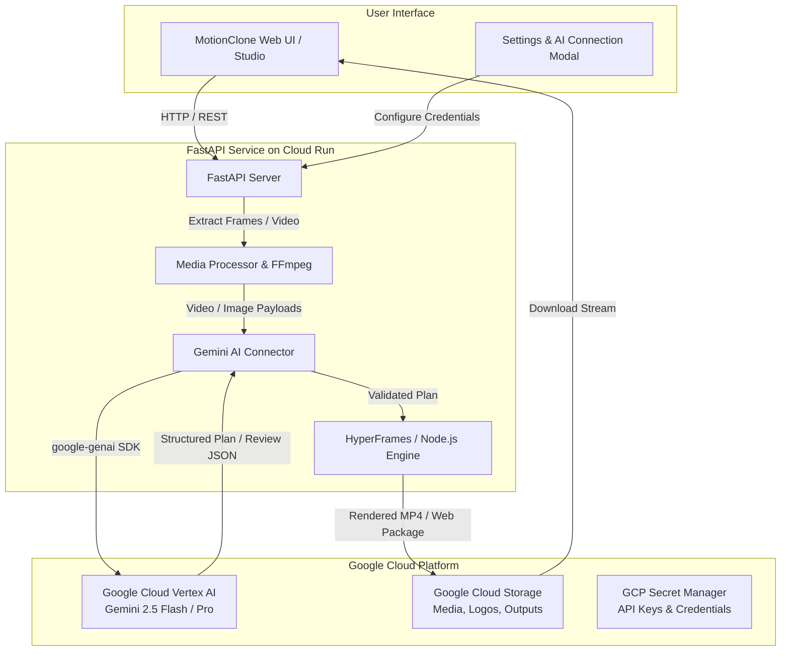

# Product Requirements Document (PRD)
## MotionClone Migration: OpenAI Codex/ChatGPT to Google Gemini (Vertex AI) & GCP

---

| **Document Version** | 1.0.0 |
| **Status** | Approved / In Implementation |
| **Owner** | MotionClone Engineering |
| **Target Engine** | Google Gemini (2.5 Flash & 2.5 Pro) on Vertex AI / Gemini API |
| **Hosting Platform** | Google Cloud Platform (Cloud Run, Cloud Storage, Artifact Registry) |

---

## 1. Executive Summary & Vision

### 1.1 Objective
Modernize **MotionClone** from an experimental, Windows-desktop application reliant on OpenAI’s local Codex CLI (`@openai/codex`) and ChatGPT device-code OAuth into an enterprise-ready, cloud-native motion reconstruction and rebranding platform powered by **Google Gemini on Vertex AI** and hosted on **Google Cloud Platform (GCP)**.

### 1.2 Core Value Proposition
- **Native Video & Multimodal Understanding:** Leverage Gemini 2.5’s massive context window (1M+ tokens) and native video processing to analyze motion, scene cuts, typography, visual hierarchies, and keyframes with significantly higher fidelity than legacy frame contact sheets.
- **Elimination of Fragile Desktop CLI Dependencies:** Remove `@openai/codex`, `codex login`, npm binaries, and ephemeral local subprocesses. Replace with the official unified Google GenAI SDK (`google-genai`).
- **Flexible Enterprise & Developer Access:** Support both **Google Cloud Vertex AI** (using Application Default Credentials, Service Accounts, or Workload Identity) and **Gemini Developer API keys** (`GEMINI_API_KEY`).
- **Cloud-Native Deployment on GCP:** Provide containerization (Docker) and Cloud Run deployment scripts so MotionClone can run serverlessly with managed autoscaling, persistent Cloud Storage (GCS) assets, and zero workstation lock-in.

---

## 2. Problem Statement & Legacy Architecture Audit

### 2.1 The Legacy Stack & Friction Points
1. **Codex CLI Coupling:**
   - Required users to install `@openai/codex` globally or find hidden binaries in `node_modules/@openai/codex-win32-x64`.
   - Used a local daemon (`codex app-server --listen stdio://`) with custom JSON-RPC pipes over stdin/stdout for authentication.
   - Device code OAuth required constant browser redirects to `auth.openai.com/codex/device`.
2. **Contact Sheet Hack:**
   - Because legacy ChatGPT models could not ingest high-framerate video directly, the app used FFmpeg to stitch video frames into dense 2D JPEG "contact sheets" and fed them via `--image` CLI flags.
3. **Execution Fragility:**
   - CLI execution (`codex exec`) had arbitrary 900s subprocess timeouts, spawned sub-processes that often escaped process tree cancellation, and produced unstructured error streams.
4. **Local Workstation Lock-in:**
   - Depended on Windows VBS scripts (`Start MotionClone.vbs`) and PowerShell (`start.ps1`) instead of containerized microservices deployable anywhere.

---

## 3. Target Architecture & Design Principles



### 3.1 Architectural Pillars

| Component | Legacy (Old) | Target (Gemini + GCP) |
| :--- | :--- | :--- |
| **LLM Provider** | OpenAI ChatGPT via Codex CLI | **Google Gemini (Vertex AI & Gemini API)** |
| **SDK / Driver** | `@openai/codex` CLI subprocess | **`google-genai` Python SDK** |
| **Model Selection** | `o3-mini`, `gpt-4o` | **`gemini-2.5-flash`** (default) & **`gemini-2.5-pro`** |
| **Authentication** | OAuth device code flow to OpenAI | **GCP ADC / Service Account / `GEMINI_API_KEY`** |
| **Schema Validation** | CLI flag `--output-schema` | **Gemini Structured Outputs (`response_schema=Plan`)** |
| **Hosting Platform** | Windows desktop loopback (`127.0.0.1:4319`) | **Google Cloud Run (Serverless Container)** |
| **Asset Storage** | Local folder `./data/` | **Google Cloud Storage (GCS) + Local Mount** |
| **Motion Renderer** | Local Node.js HyperFrames + FFmpeg | **Containerized Node 22 + FFmpeg + HyperFrames** |

---

## 4. Functional Specifications

### 4.1 Gemini AI Reconstruction Engine (`app/ai.py`)
- **Unified Client Initialization:**
  - Auto-detect GCP Vertex AI configuration: if `GOOGLE_CLOUD_PROJECT` or `VERTEXAI_PROJECT` is set, initialize with `genai.Client(vertexai=True, project=..., location=...)`.
  - Fallback to Gemini Developer API: if `GEMINI_API_KEY` is present, initialize with `genai.Client(api_key=...)`.
  - Allow runtime configuration via Settings UI (saving keys locally or in user profile).
- **Multimodal Video & Frame Analysis:**
  - Pass timestamped extracted frames or direct video stream to Gemini.
  - Deliver comprehensive scene analysis instructions (coordinate normalization, keyframe easing, opacity/blur, track hierarchy).
- **Guaranteed Structured Output:**
  - Leverage Gemini's strict `response_mime_type="application/json"` and `response_schema=Plan` (or `Review` for second-pass refinement).
  - No prompt markdown parsing required; Gemini returns valid, parseable JSON directly mapped into Pydantic models.
- **Review & Refinement Mode:**
  - In review mode, send original reference frames alongside current rendered preview frames to Gemini.
  - Return a strict `Review` patch (`replace_tracks`, `remove_tracks`, `replace_masks`, `remove_masks`) and apply non-destructively.

### 4.2 Account & Connection Management (`app/connection.py`)
- Retire Codex RPC daemon and child process spawning.
- Introduce `GeminiConnection` manager:
  - Check availability of Google Cloud ADC credentials or Gemini API Key.
  - Query Gemini model status (`client.models.get(model='gemini-2.5-flash')`) to verify quota, network latency, and authorization.
  - Report status to frontend via `/api/status` and `/api/account`.

### 4.3 Web UI & Settings Modernization
- **Account Modal (`web/account.html` & `web/account.js`):**
  - Replace "ChatGPT connection" and "Codex login" with **"Google Gemini & Vertex AI Connection"**.
  - Provide input fields for:
    1. **Gemini API Key** (Quick setup / Developer API)
    2. **GCP Project ID & Region** (Enterprise Vertex AI setup)
    3. **Model Selection:** `gemini-2.5-flash` (Fast, recommended) or `gemini-2.5-pro` (Deep reasoning)
  - Display live connection badge: "Connected to Vertex AI" or "Gemini API Ready".
- **Studio & Editor (`web/index.html`, `web/editor.html`):**
  - Update all user notices, privacy notes, and action buttons ("Refine with Gemini", "Reconstructed by Gemini").

---

## 5. GCP Hosting & Cloud Run Architecture

### 5.1 Containerization Requirements
The service requires a multi-runtime container bundling:
1. **Operating System:** Ubuntu 24.04 LTS or Debian 12 Slim.
2. **Python Environment:** Python 3.12 with all application dependencies (`fastapi`, `uvicorn`, `google-genai`, `opencv-python-headless`, `pillow`, `pydantic`).
3. **Node.js Environment:** Node.js 22 LTS with npm, housing the `hyperframes` engine.
4. **Media Processing:** FFmpeg 7+ and `ffprobe` compiled with standard codec support (h264, aac).

### 5.2 Google Cloud Run Specification
- **Service Name:** `motionclone-studio`
- **Memory:** 4 GiB (to accommodate video frame extraction and HyperFrames headless rendering).
- **CPU:** 2 vCPU.
- **Concurrency:** 8-16 requests per container.
- **Request Timeout:** 900 seconds (allowing 120-second video analyses and renders).
- **Authentication:** Service Account with `roles/aiplatform.user` for frictionless, keyless Vertex AI calls.
- **Environment Variables:**
  - `GOOGLE_GENAI_USE_VERTEXAI=true`
  - `GOOGLE_CLOUD_PROJECT=<PROJECT_ID>`
  - `GOOGLE_CLOUD_LOCATION=us-central1`
  - `FRAMEFORGE_HOSTED=1`
  - `FRAMEFORGE_DATA=/mnt/data` (or Cloud Storage bucket mount via gcsfuse).

---

## 6. Migration Plan & Implementation Steps

```
[Phase 1: Backend Core Migration]
  ├── Update requirements.txt to include google-genai
  ├── Re-implement app/ai.py with Google GenAI SDK (Vertex AI + API Key)
  ├── Replace app/connection.py with GeminiConnection manager
  └── Update app/server.py endpoints (/api/status, /api/account)

[Phase 2: Frontend & UX Alignment]
  ├── Update web/account.html & web/account.js for Gemini / Vertex AI config
  ├── Update web/index.html, web/editor.html, web/editor.js, web/app.js
  └── Remove all legacy references to ChatGPT and Codex

[Phase 3: GCP Cloud Run Containerization]
  ├── Create Dockerfile (Python 3.12 + Node.js 22 + FFmpeg + HyperFrames)
  ├── Create .dockerignore & cloudbuild.yaml
  └── Add GCP deployment guide and launch scripts

[Phase 4: Validation & Testing]
  ├── Verify API connection check
  ├── Verify structured Plan generation
  └── Confirm HyperFrames video compilation
```

---

## 7. Success Metrics & KPIs
1. **Zero Codex Dependency:** 100% elimination of `@openai/codex` CLI and OpenAI login requirements.
2. **Setup Time:** Reduce local/cloud setup friction from ~15 minutes (with Codex device codes) to under 60 seconds (API key or native Cloud Run ADC).
3. **Structured Schema Compliance:** 100% valid JSON conforming to `Plan` and `Review` models via Gemini's native structured outputs.
4. **Cloud Portability:** 1-click deployment to Google Cloud Run with full video rendering capabilities.
